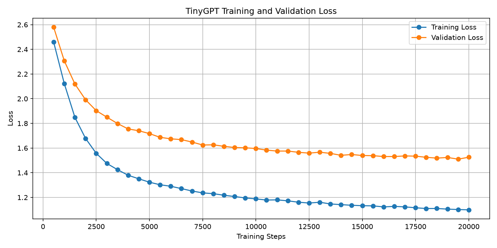

# TinyGPT From Scratch with PyTorch

An educational, character-level GPT built from scratch with PyTorch. The project trains a small decoder-only Transformer on English Wikipedia extracts about artificial intelligence, then generates text one character at a time.

> **Scope:** This is a learning project, not a production-ready language model or a conversational chatbot.

## What it demonstrates

- Character-level vocabulary, encoding, and decoding
- Causal self-attention and multi-head attention
- Transformer blocks, residual connections, and dropout
- Training/validation splits, loss monitoring, and early stopping
- Sampling generated text from a trained model

## Training results

The chart below shows the training and validation loss from a run of up to 20,000 steps. Results depend on the fetched dataset, random initialization, and hardware.



## Quick start

Use Python 3.10 or later and install a PyTorch build suitable for your operating system and hardware. For CUDA support, follow the selector at [pytorch.org/get-started/locally](https://pytorch.org/get-started/locally/).

```bash
python -m venv .venv
```

Activate the environment:

```bash
# Windows PowerShell
.\.venv\Scripts\Activate.ps1

# macOS / Linux
source .venv/bin/activate
```

Install dependencies, fetch the training text, and start training:

```bash
python -m pip install --upgrade pip
python -m pip install -r requirements.txt
python fetch_wiki_ai.py
python tiny_gpt.py
```

Fetching the Wikipedia extracts requires an internet connection. Training can take a long time, especially on CPU. The script automatically uses CUDA when available.

After training, the script saves the loss plot as `tiny_gpt_loss.png` and the best model weights to `models/tiny_gpt_best.pth`. It also prints sample generations to the terminal.

## Project files

| File | Description |
| --- | --- |
| `tiny_gpt.py` | Model, training loop, evaluation, and text generation |
| `fetch_wiki_ai.py` | Downloads and prepares the English AI training corpus |
| `tiny_gpt_loss.png` | Example training and validation loss plot |
| `requirements.txt` | Python package requirements |

The training corpus and model checkpoint are not included. The corpus is fetched locally when you run `fetch_wiki_ai.py`; checkpoints and downloaded data are excluded from Git.

## Data and licensing

The fetcher retrieves article extracts from the [Wikimedia API](https://www.mediawiki.org/wiki/API:Main_page). Wikipedia text is generally available under [CC BY-SA](https://en.wikipedia.org/wiki/Wikipedia:Copyrights); those terms apply to the source text and are separate from this repository's MIT license. The fetched corpus is not redistributed here.

The MIT license applies to this repository's code and original documentation. See [LICENSE](LICENSE).

## العربية

مشروع تعليمي لبناء نموذج GPT صغير على مستوى الأحرف باستخدام PyTorch. يتعلّم النموذج من مقتطفات ويكيبيديا الإنجليزية عن الذكاء الاصطناعي، ثم يولّد النص حرفًا بعد حرف.

- يشرح آلية **Causal Self-Attention** وطبقات Transformer.
- يقيس خسارة التدريب والتحقق، ويستخدم الإيقاف المبكر.
- يتطلب تنزيل بيانات التدريب وتشغيل التدريب محليًا؛ لا يتضمن النموذج المدرّب.
- ليس روبوت محادثة أو نموذجًا جاهزًا للاستخدام الإنتاجي.

للبدء، ثبّت PyTorch المناسب لجهازك، ثم اتبع أوامر التثبيت والتنزيل والتدريب أعلاه. يحتاج تنزيل البيانات إلى اتصال بالإنترنت، وقد يستغرق التدريب وقتًا طويلًا.

---

Built as a hands-on introduction to the mechanics behind small GPT-style language models.
